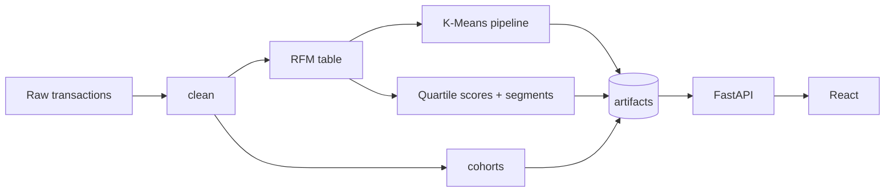

# From notebook to service

`retail_project.ipynb` was a one-off analysis: it read a local `online_retail.xlsx`, printed tables and drew seaborn heatmaps. This is how it became a reproducible service, and what a real deployment would still need.

## What changed

| Notebook | Service |
|---|---|
| Local xlsx you had to download by hand | `segmentation.build` downloads the UCI zip (`DATA_URL`) at build time |
| Cells run top to bottom with global state | Pure functions in `segmentation/core.py`, unit-tested |
| `Data` class that mostly prints stats (`legacy/data_class.py`) | Cleaning is one function: `core.clean` |
| Quartile functions applied with `.apply` per column | `core.score` with a direction flag, reused by `/assign` for new customers |
| 13 K-Means clusters relabelled by hand | k=4 on log-scaled RFM, names derived from cluster medians |
| CSV/PNG outputs | `artifacts/` (customers.csv, kmeans.joblib, meta.json) loaded by FastAPI |
| Seaborn charts | React dashboard |

## Pipeline

## Next steps for production

1. **Fresh data.** Swap the UCI download for the orders warehouse (for example a dbt model producing one row per order line). Snapshot date becomes "today", not the fixed `2011-12-09`.
2. **Scheduled rebuilds.** Run `segmentation.build` nightly or weekly as a job (Airflow, GitHub Actions cron or a Kubernetes CronJob), write artifacts to object storage with a version, and have the API load the newest one.
3. **Stable cluster names.** K-Means IDs change between fits. The value-rank naming keeps names stable as long as the clusters stay ordered. Track the centroid drift and the silhouette score per run, and alert when either jumps.
4. **Experiment tracking.** Log k, silhouette, segment sizes and the quartile cut-offs per run (MLflow or similar) so you can explain why a customer moved segment.
5. **Serving at scale.** `customers.csv` is loaded into memory, which is fine for thousands of customers. For millions, store segments in a database table keyed by customer ID and keep only `/assign` model-backed.
6. **Activation.** Push segments to the CRM or email tool (a reverse-ETL job), and measure campaign lift per segment.
7. **Monitoring.** Watch the shift in each RFM feature's distribution and the segment mix over time. A sudden swing usually means a data issue, not a change in customer behaviour.

Auth, rate limiting and PII handling are intentionally out of scope for this local build.
