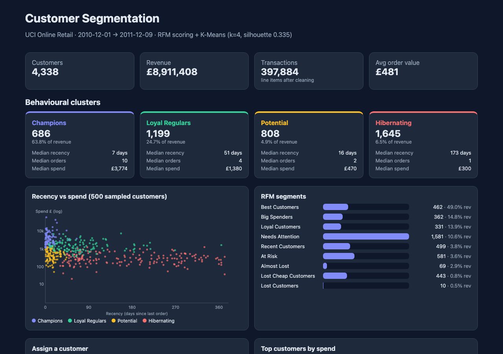
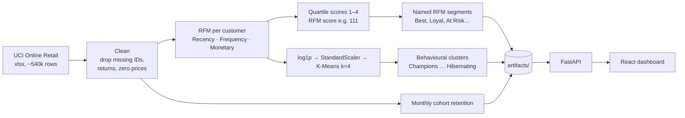
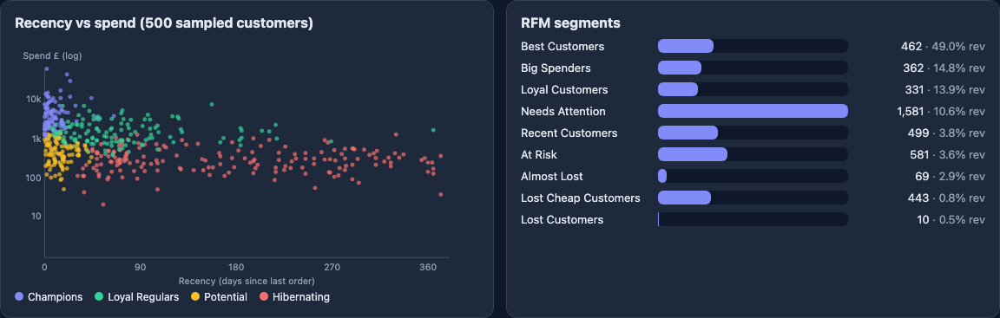
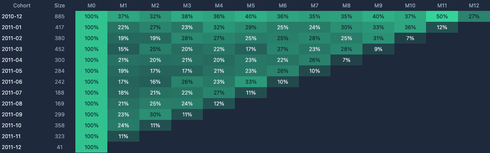
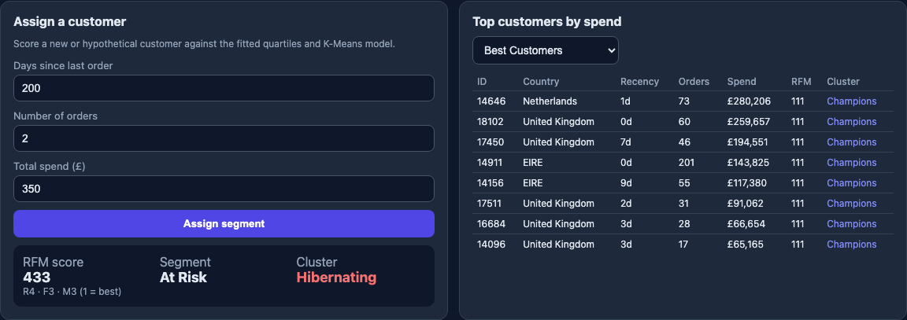
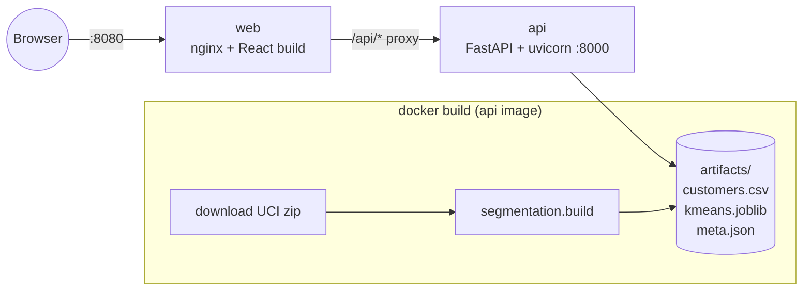
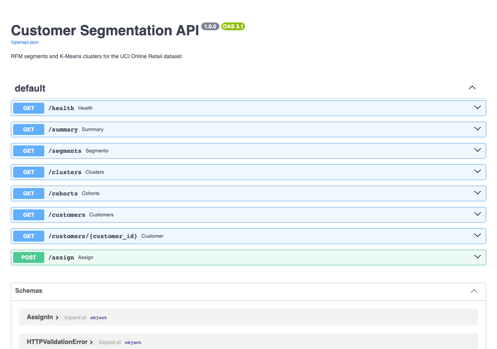

# Customer Segmentation: RFM + K-Means Dashboard

<p align="center"></p>

<p align="center"></p>

> Who are your best customers, who is slipping away, and which group does a new customer belong to?
> This repo turns the `retail_project.ipynb` analysis of the **UCI Online Retail** dataset into a running app:
> a **FastAPI** service plus a **React** dashboard, started with one `docker compose up`.



---

## Business case

Marketing budgets go further when each group of customers gets the offer that fits it. This app scores customers by recency, frequency and spend, clusters them with K-Means, and assigns new customers to a segment through an API. On the UCI Online Retail data, about 16% of customers bring in about 64% of revenue, which is why the groups matter. [docs/BUSINESS_CASE.md](docs/BUSINESS_CASE.md) covers the use cases, an illustrative ROI model and the limits.

## 1. The problem

A UK online gift retailer has **397,884 cleaned transactions** from **4,338 customers** between Dec 2010 and Dec 2011, worth about **£8.9M**.
Marketing can't treat 4,338 people one at a time, and treating them all the same wastes budget. Segmentation splits them into groups that behave alike, so each group gets its own playbook.

## 2. The approach



Two complementary views:

| View | How it works | Good for |
|---|---|---|
| **RFM segments** | Each customer gets a 1–4 score on R, F and M (1 = best) from the dataset's quartiles. Rules map scores to names: `111` Best Customers, `411` Lost Customers, `444` Lost Cheap, F=1 Loyal, M=1 Big Spenders… | Explainable rules a marketer can read |
| **K-Means clusters** | RFM values are log-transformed, standardized and clustered (k=4, silhouette 0.335). Clusters are named by ranking their median value. | Data-driven groups with no hand-set thresholds |

## 3. What came out



| Cluster | Customers | Share of revenue | Median recency | Median orders | Median spend |
|---|---:|---:|---:|---:|---:|
| **Champions** | 686 | 63.8% | 7 days | 10 | £3,774 |
| **Loyal Regulars** | 1,199 | 24.7% | 51 days | 4 | £1,380 |
| **Potential** | 808 | 4.9% | 16 days | 2 | £470 |
| **Hibernating** | 1,645 | 6.5% | 173 days | 1 | £300 |

**About 16% of customers bring in about 64% of revenue.** The Potential group is recent but light, so it's the natural target for a second-purchase campaign. Hibernating is the largest group and needs win-back offers, or no spend at all.

### Cohort retention



Typically 20–25% of a monthly cohort comes back the next month. The December 2010 cohort, which holds the earliest and most loyal buyers, stays at 30–50% all year.

## 4. Assign a new customer

Enter days since last order, number of orders and total spend. The API scores the customer against the fitted quartiles and K-Means model.



```bash
curl -X POST localhost:8000/assign -H 'content-type: application/json' \
  -d '{"recency": 200, "frequency": 2, "monetary": 350}'
# {"R":4,"F":3,"M":3,"rfm_score":"433","segment":"At Risk","cluster":"Hibernating"}
```

## 5. Architecture

<p align="center"></p>



The dataset is **downloaded and the model fitted during `docker build`**, so no data or model files are committed.

| Endpoint | Purpose |
|---|---|
| `GET /health` | Liveness |
| `GET /summary` | KPIs, period, monthly revenue |
| `GET /segments` | RFM segment sizes, revenue share and medians |
| `GET /clusters` | K-Means cluster profiles |
| `GET /cohorts` | Monthly cohort retention matrix |
| `GET /customers?segment=&cluster=&limit=&sample=` | Top (or sampled) customers |
| `GET /customers/{id}` | One customer's RFM, segment and cluster |
| `POST /assign` | Score a new customer |



## 6. Run it

```bash
cp .env.example .env
docker compose up --build      # first build downloads ~23 MB and fits the model (~1 min)
# dashboard: http://localhost:8080   API docs: http://localhost:8000/docs
docker compose down
```

Local development without Docker:

```bash
uv sync
uv run python -m segmentation.build          # writes artifacts/
uv run uvicorn segmentation.api:app --reload  # :8000
cd web && npm install && npm run dev          # :5173, proxies /api to :8000
uv run pytest -q
```

Screenshots are taken from the running stack with `uv run --with playwright python scripts/screenshots.py`.

## 7. Repo map

```
src/segmentation/   core.py (cleaning, RFM, scoring, K-Means, cohorts) · build.py · api.py
web/                React + Vite + TypeScript dashboard, served by nginx
tests/              pytest unit + API tests on synthetic data
retail_project.ipynb  original analysis notebook
docs/ANALYSIS.md    original write-up of the notebook
PRODUCTIONIZING.md  notebook → service notes
legacy/             superseded helper code (data_class.py)
```

## Differences from the notebook

- **Frequency** counts distinct invoices. The notebook counted invoice *lines*, which inflates customers who order many items at once.
- **k = 4** instead of 13. Thirteen clusters were later merged by hand into Low, Middle and High. Four log-scaled clusters give readable profiles directly, and `N_CLUSTERS` in `.env` changes k.
- RFM segments are **mutually exclusive** (rules are checked in priority order), so their counts add up to the customer total.
